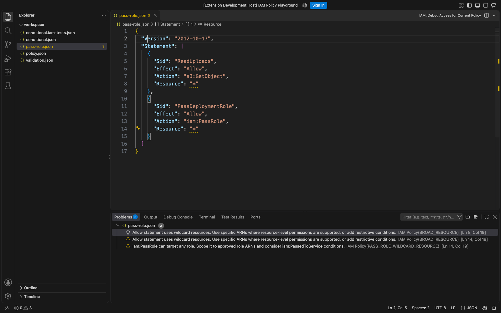
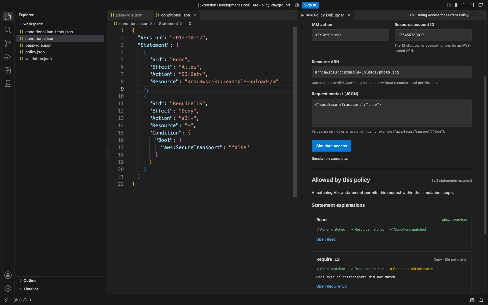
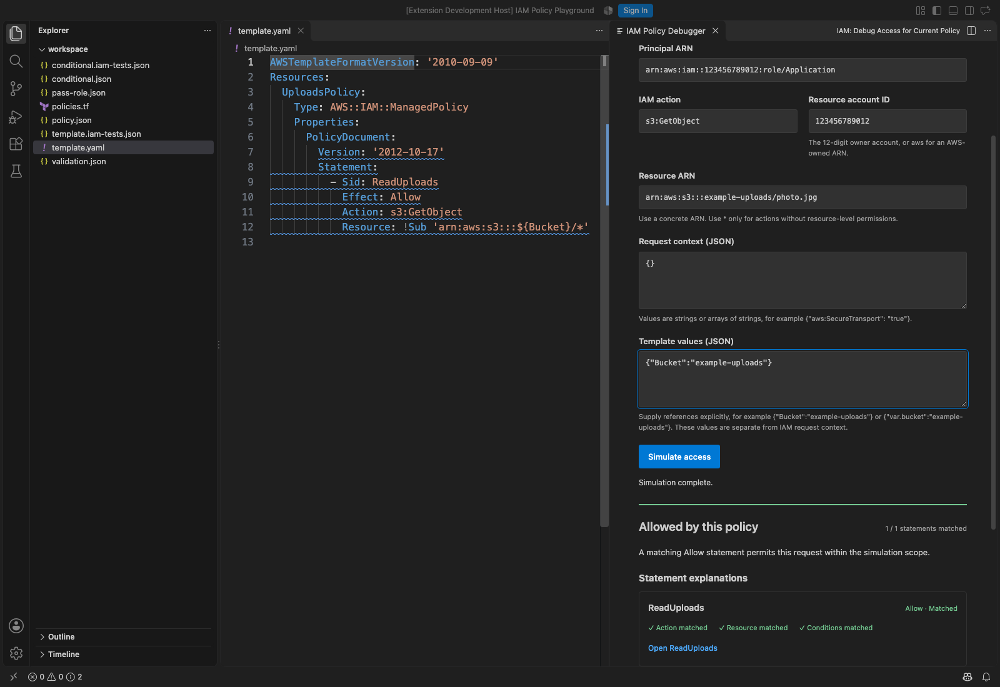
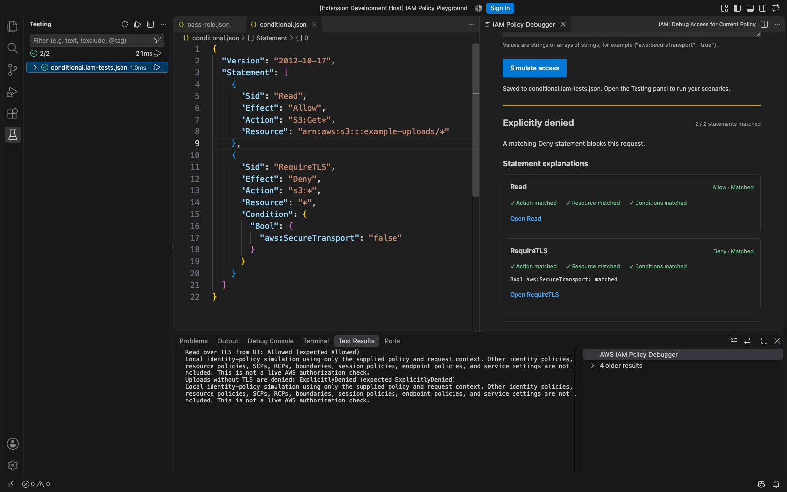
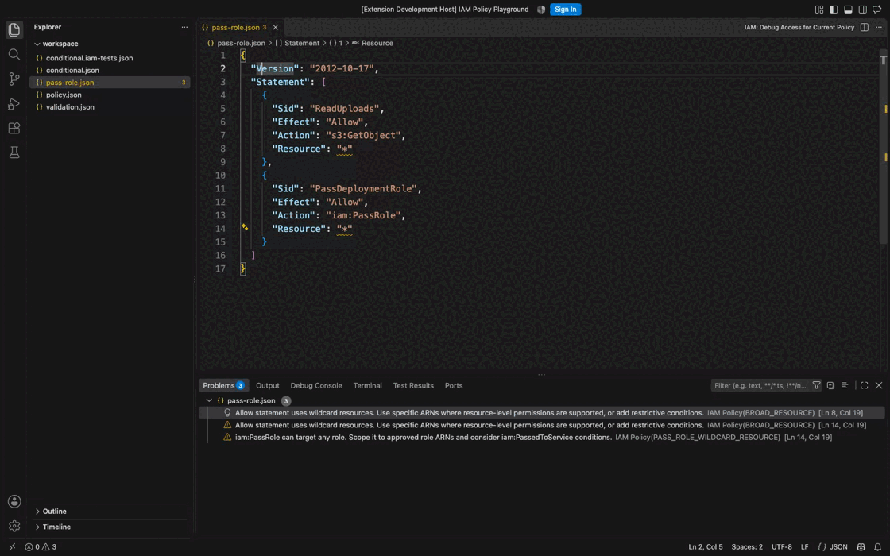

# AWS IAM Policy Debugger


**Unpublished development preview.** This extension is not available in the VS Code Marketplace. Build a local VSIX from this checkout to try it.

Validate IAM policies while you edit, explain an identity-policy access decision, and keep the expected outcome as a regression test. Everything runs locally in VS Code. No AWS credentials are required.

<!-- TIP-LIST:START -->
> [!TIP]
> **Catch AWS waste before and after you deploy.**
>
> [CloudBurn](https://cloudburn.io) is a free, open-source CLI that checks your Terraform and CloudFormation for costly patterns before deploy, then finds the waste already running in your AWS account. Run it locally or in CI.
>
> <a href="https://github.com/towardsthecloud/cloudburn"></a>
>
> Want it managed across your AWS accounts? [CloudBurn Platform](https://cloudburn.io) runs it for you and keeps scan results in your own account. Join the waitlist for 30% off.
<!-- TIP-LIST:END -->

- Catch policy errors and security warnings as editor squiggles and Problems entries.
- See why each statement matched or failed: action, resource, and individual conditions.
- Jump from the explanation to the statement in your editor.
- Save a named scenario and choose its expected outcome.
- Discover and run `*.iam-tests.json` files in the Testing panel.
- Test current editor contents, including unsaved policy changes.
- Debug policies inside CloudFormation JSON/YAML and Terraform files with explicit template values.
- Run the same saved scenarios in CI with a local CLI.

## See it in action

These are real captures of the packaged preview in an isolated VS Code profile, using disposable example policies and a fictional AWS account.

### Validate as you edit

Spot broad permissions and `iam:PassRole` on every role, with findings located on the values you need to review.



### Explain an access decision

Inspect each statement's action, resource and condition matches beside the policy. Save the request and its expected decision as a named scenario.



### Debug a policy inside a template

Select an embedded policy and supply its template references explicitly. The same selection and values are saved with the scenario for VS Code and CI.



### Run policy regression tests

Saved scenarios appear in VS Code's Testing panel. They use current editor contents, so you can test a policy change before saving it.



### Short demo

Scope broad permissions to clear the warnings, simulate a read over TLS, then remove TLS and see the explicit Deny match.



## Build and try the preview

Use Node.js 24 and VS Code 1.85 or newer. From this checkout:

```sh
fnm use
npm ci
npm run package
```

Run **Extensions: Install from VSIX** in VS Code and select `.vscode-test/iam-policy-debugger.vsix`. You can also press F5 after `npm run compile` to open an Extension Development Host with the examples workspace.

1. Open a trusted local workspace containing identity-policy JSON, CloudFormation JSON/YAML or Terraform files. The [examples](examples/) include standalone and template policies with saved scenarios.
2. Open the file and run **IAM: Debug Access for Current Policy** from the Command Palette. It is also available in the editor toolbar and Explorer context menu. If the file contains multiple policies, choose one from the policy picker.
3. Enter a concrete IAM user/role ARN, action, resource ARN, and resource account ID. Use `aws` as the account ID for an AWS-owned ARN such as `arn:aws:iam::aws:policy/AWSLambdaExecute`. For the uploads example, use `s3:GetObject` and `arn:aws:s3:::example-uploads/photo.jpg` in account `123456789012`.
4. Supply request context explicitly, for example `{"aws:SecureTransport":"true"}`. Principal/account fields identify the scenario; they do **not** automatically populate condition keys such as `aws:PrincipalArn` or `aws:ResourceAccount`.
5. For embedded policies, supply **Template values** separately from request context, for example `{"Bucket":"example-uploads"}` for CloudFormation or `{"var.bucket":"example-uploads"}` for Terraform. Click **Simulate access**. Expand the scope description and inspect each statement. Click a statement’s **Open** button to select its source.
6. Give the scenario a name and choose **Allowed**, **Explicitly denied**, or **Implicitly denied**. Save it, then run it in the Testing panel.

The policy must be saved before you save a scenario. Saves to the same scenario file are serialized within an extension host. Existing scenarios are preserved; duplicate names and dirty scenario files produce errors. Changing the request or policy clears the debugger result until you simulate again.

## Policy validation

Open an IAM JSON policy, CloudFormation JSON/YAML template or Terraform file. Documents with a top-level `Statement` or an IAM language `Version` are recognized automatically. Findings update with unsaved edits; ordinary project JSON and `*.iam-tests.json` suites are excluded. Open documents are checked after activation, including policies opened later in the session. Embedded findings point to template source; unresolved references appear as informational findings and require explicit values before simulation.

Errors cover strict JSON syntax, duplicate JSON keys, required statement elements, conflicting element pairs, effects, versions, data types, ARN shape, concrete action names in the bundled catalog, condition structure, invalid condition operators, multiple Bool values, and condition keys with conflicting capitalization. Warnings cover missing versions, wildcard actions/resources, public principals, broad `iam:PassRole`, and Allow statements using `NotAction` or `NotResource`.

Validation accepts resource policies, role trust-policy structure, policy variables, and standard condition operators such as Numeric, Date and IP. The debugger supports the smaller identity-policy subset below. These are local structural and best-practice checks inspired by the [web policy validator](https://towardsthecloud.com/tools/aws-iam-policy-validator). They do not call AWS Access Analyzer or implement all its service-specific checks. A clean Problems view does not prove deployment validity or least privilege.

## What a decision means

**Allowed by this policy** means an Allow statement matched and no Deny statement matched within this one policy. **Explicitly denied** means a Deny statement matched. **Implicitly denied** means no Allow statement matched.

This is a policy-matching tool, not an effective-permissions calculation or a live AWS authorization check. It excludes other identity policies, resource policies, SCPs, RCPs, permissions boundaries, session policies, endpoint policies, service settings, and dependent actions. Cross-account authorization still requires the appropriate resource-side permissions. The supplied context is treated as a hypothetical request; the extension does not verify whether AWS would supply those keys for that action.

## Supported policy features

| Feature                | Support                                                                                      |
| ---------------------- | -------------------------------------------------------------------------------------------- |
| Identity-policy JSON   | Single statement or array; strict JSON without comments                                      |
| Allow / Deny           | Explicit Deny takes precedence                                                               |
| Action / NotAction     | String or array; `*` and `?`; case-insensitive                                               |
| Resource / NotResource | String or array; `*` and `?`; incomplete identity ARNs filled with wildcards; case-sensitive |
| String conditions      | Equals, NotEquals, EqualsIgnoreCase, NotEqualsIgnoreCase, Like, NotLike                      |
| ARN conditions         | Equals, Like, NotEquals, NotLike; component-wise wildcards                                   |
| Numeric conditions     | Equals, NotEquals, LessThan, LessThanEquals, GreaterThan, GreaterThanEquals                  |
| Date conditions        | The same comparisons using ISO 8601 timestamps or epoch seconds                              |
| IP conditions          | IpAddress / NotIpAddress; IPv4 and IPv6 addresses and CIDRs                                  |
| IAM policy variables   | Single-valued context substitutions and defaults in Resource and String/ARN values           |
| Boolean / existence    | Bool and Null                                                                                |
| Optional keys          | IfExists for supported operators except Null                                                 |
| Multivalue context     | ForAnyValue and ForAllValues for String, ARN, Numeric, Date and IP operators                 |

Conditions across keys/operators use AND. Positive policy values use OR; negated values use NOR. Missing-key and empty-set behavior follows the supported AWS condition operators. Unqualified operators require a single request value; use a set operator for arrays containing multiple values. Combining set qualifiers with IfExists is not supported.

Unsupported operators (including BinaryEquals), Principal/NotPrincipal, and malformed policy features return errors even in unmatched statements. IAM role sessions, anonymous/service principals, and actions requiring multiple required resource types are not supported. Use `*` as the request resource only for actions without resource-level permissions. The bundled MIT IAM catalog validates action names and resource types; it is a release snapshot, not a live catalog.

AWS references: [policy evaluation](https://docs.aws.amazon.com/IAM/latest/UserGuide/reference_policies_evaluation-logic.html), [condition operators](https://docs.aws.amazon.com/IAM/latest/UserGuide/reference_policies_elements_condition_operators.html).

## Embedded policies

CloudFormation JSON/YAML policies are selected by JSON pointer, for example `/Resources/UploadsPolicy/Properties/PolicyDocument`. `Ref`, `Fn::GetAtt`, `Fn::Sub` and `Fn::Join` are supported inside the policy. Supply values for references such as `Bucket`, `AWS::AccountId` or `Bucket.Arn`; parameters and pseudo parameters are not inferred. In `Fn::Sub`, use `${!aws:username}` to preserve an IAM variable.

Terraform supports literal/heredoc JSON and `jsonencode` policies in `aws_iam_policy`, inline user/group/role policy resources and `aws_iam_role.inline_policy`. It also supports literal `aws_iam_policy_document` statement and condition blocks. Choose an address such as `resource.aws_iam_policy.uploads.policy` or `data.aws_iam_policy_document.delete`. Supply references by their full expression, such as `var.bucket`. Escape IAM variables as `$${aws:username}` in Terraform templates, or `&{aws:username}` in `aws_iam_policy_document` blocks.

The extension does not execute Terraform, read state, contact AWS, or evaluate arbitrary functions, loops, dynamic blocks, policy-document merges or unsupported CloudFormation intrinsics. These produce errors instead of guessed decisions. CDK users can inspect policies in synthesized CloudFormation output; TypeScript/Python CDK source is not evaluated. See [template examples](examples/templates.iam-tests.json).

IAM policy variables require `Version: "2012-10-17"`. Resource substitutions are restricted to the resource portion after the fifth colon. Conditions support substitutions in String and ARN values. Context values must be single-valued; missing variables do not match positive operators. Defaults such as `${aws:PrincipalTag/team, 'shared'}` are supported.

## Scenario format

Each scenario file contains `version: 1` and a `tests` array. The extension supplies JSON completion and validation for these files. Policy paths are relative to the scenario file and must stay inside its workspace folder. Embedded scenarios also save `policyId` and `templateValues`; existing standalone scenario files remain compatible.

```json
{
  "version": 1,
  "tests": [{
    "name": "Application can read uploads over TLS",
    "policy": "uploads.json",
    "expected": "Allowed",
    "request": {
      "principal": "arn:aws:iam::123456789012:role/Application",
      "action": "s3:GetObject",
      "resource": "arn:aws:s3:::example-uploads/photo.jpg",
      "resourceAccountId": "123456789012",
      "context": {"aws:SecureTransport": "true"}
    }
  }]
}
```

Context values are strings or arrays of strings. Use `"true"` / `"false"` for request boolean values. Context key names are case-insensitive; ambiguous duplicates and explicit null context are rejected. Policy Bool/Null values may also be JSON booleans.

Run all or selected scenarios from the Testing panel, or use **IAM: Run Scenarios in Current File**. Mismatches appear as failed tests; invalid or unsupported policy inputs appear as errors. The Testing panel output includes the evaluation scope.

## Run scenarios in CI

The CLI uses the same evaluator and scenario format as VS Code. Build this unpublished preview from a checkout, then run:

```sh
npm ci
npm run compile
node out/cli.cjs examples --root .
node out/cli.cjs examples --root . --json > iam-results.json
```

It reads saved files; VS Code's Testing panel can also use unsaved buffers. Directory discovery skips `node_modules`, `.git`, `.vscode-test`, `out` and symbolic links. The default root and target are the current directory. Policy files and suite files must stay inside the root, including resolved symbolic links. Use `--root` when running from another directory.

Exit codes are **0** when every scenario passes, **1** for an expectation mismatch, and **2** for invalid input, unsupported policies, unresolved references or no scenarios. Empty suites fail rather than give a false green check. JSON output includes the scope, counts and each scenario's actual decision or error.

For GitHub Actions, after checkout and Node setup, use a step like this in your policy repository (with this preview checkout at `tools/iam-policy-debugger`):

```yaml
- name: Test IAM policies
  run: |
    npm ci --prefix tools/iam-policy-debugger
    npm run compile --prefix tools/iam-policy-debugger
    node tools/iam-policy-debugger/out/cli.cjs policies --root . --json
```

## Related extensions

- [AWS IAM Actions Snippets](https://marketplace.visualstudio.com/items?itemName=dannysteenman.iam-actions-snippets) completes IAM actions and explains wildcard matches while authoring policies.
- [AWS IAM Service Principal Snippets](https://marketplace.visualstudio.com/items?itemName=dannysteenman.iam-service-principal-snippets) completes service principals in trust policies and CDK roles.
- The [Terraform](https://github.com/towardsthecloud/vscode-terraform-extension-pack), [CloudFormation](https://github.com/towardsthecloud/vscode-cloudformation-extension-pack) and [CDK](https://github.com/towardsthecloud/vscode-cdk-extension-pack) extension packs are being updated to include this debugger after its Marketplace release.

## Development

Scaffold adapted from [AWS IAM Actions Snippets](https://github.com/towardsthecloud/vscode-iam-actions-snippets).

```sh
fnm use
npm ci
npm run compile
npm test
npm run test:integration -- 1.85.0
npm run package
```

Press F5 to launch an Extension Development Host with the examples workspace. Packaging writes `.vscode-test/iam-policy-debugger.vsix`. Integration tests unpack and execute that VSIX in an isolated VS Code profile. On Linux, run `xvfb-run -a npm test`. Reports are saved under `.vscode-test/results/`. CI tests the minimum and stable VS Code releases and produces a VSIX artifact without publishing it.

For interactive UI validation, run `IAM_UI_TEST=1 npm run test:integration -- stable`, attach `playwright-cli -s=iam attach --cdp=http://127.0.0.1:9241`, and run `playwright-cli -s=iam run-code --filename=tests/playwright-ui.cjs`. The test host waits up to 10 minutes; finish with `curl http://127.0.0.1:9242`. The UI script exercises simulation, saving, invalidation, navigation, and a narrow panel. Its screenshot and trace stay in `.vscode-test/results/`. See [capture instructions](docs/images/README.md) for the README screenshots and demo.

## Publish a release

1. Add the repository Actions secrets `VSCE_TOKEN` (Visual Studio Marketplace) and `OPEN_VSX_TOKEN` (Open VSX),
   with publishing access for `dannysteenman`.
2. Update `package.json`, `package-lock.json`, and `CHANGELOG.md` for the release, and merge the changes into `main`.
3. From the intended release commit on `main`, create and push a tag matching the package version,
   such as `v0.1.0` for version `0.1.0`:

   ```sh
   version=$(node -p 'require("./package.json").version')
   git tag "v$version"
   git push origin "v$version"
   ```

The release workflow checks the tag and main ancestry, then runs the existing minimum and stable VS Code checks.
Only after both pass does it publish the stable job's validated VSIX to both registries without rebuilding it.
Pull requests and pushes to `main` validate without publishing.
If one registry fails, rerun the release workflow; already-published versions are skipped.

## License

Apache-2.0. See [LICENSE](LICENSE) and [NOTICE](NOTICE). The policy evaluator is independently implemented. The bundled [ACT Security Labs IAM catalog](https://github.com/act-security-labs/iam-data) is MIT-licensed; its license is retained in `licenses/iam-data.txt`. No ACT simulator code is included. JSON parsing and IP handling use MIT dependencies; YAML uses ISC. The unmodified Terraform parser is distributed separately under MPL-2.0 with its license and source link in NOTICE. These dependency licenses are retained; this repository’s own code remains Apache-2.0.
